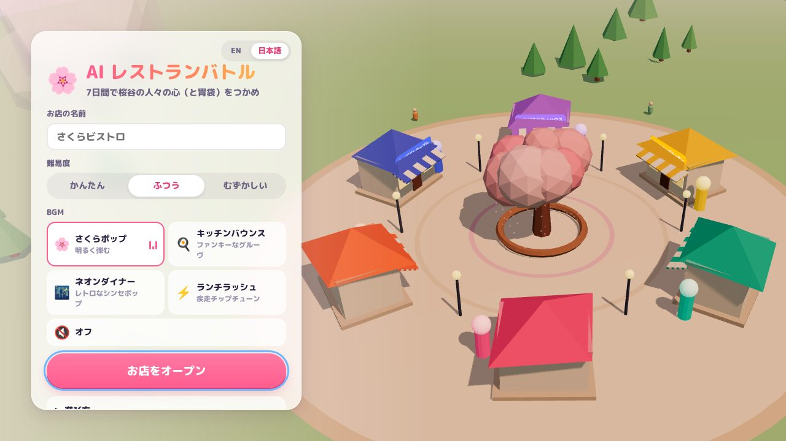
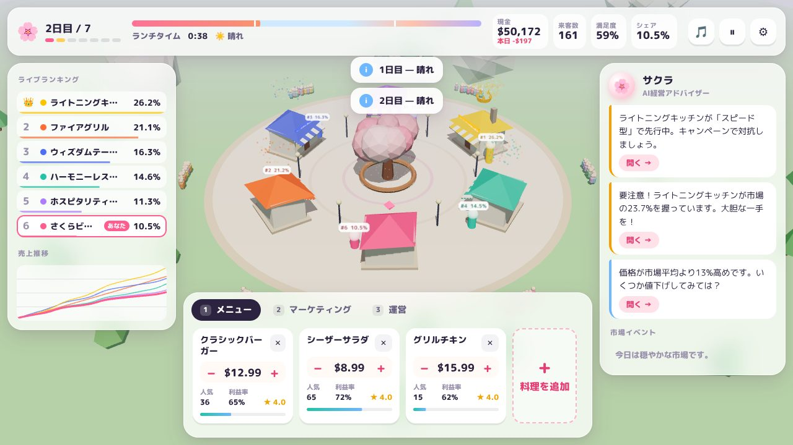
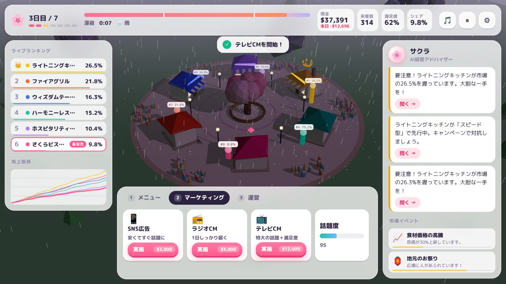
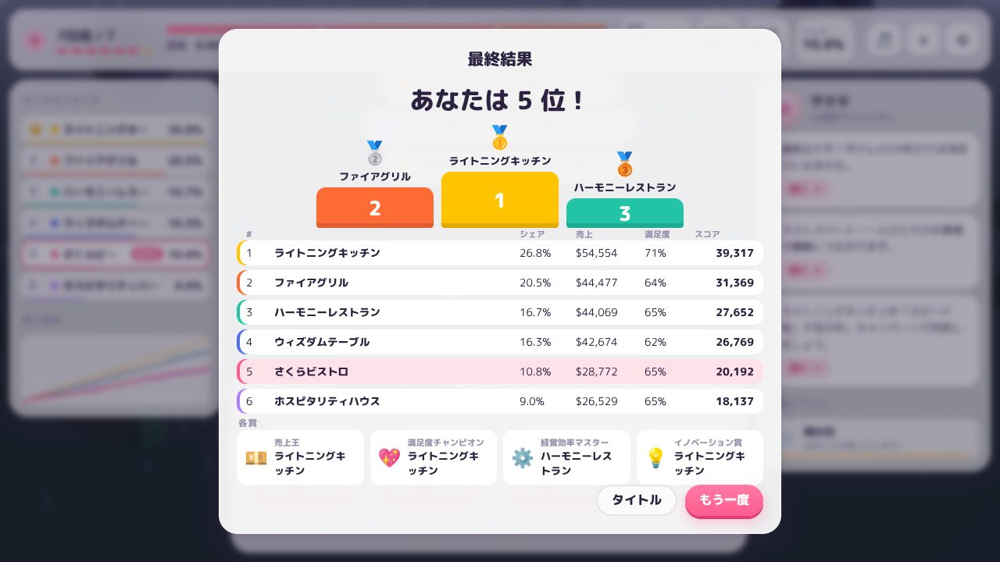

# AI Restaurant Battle 🌸

A 3D restaurant-management battle in the browser: run your shop on a low-poly
plaza in Sakura Valley and out-sell five AI-run rivals in **7 in-game days
(7 minutes)**.

3D の広場で 5 つの AI ライバル店と 7 日間（7 分）で市場シェアを競う、ブラウザ向けレストラン経営バトルです。



| Day | Dusk & rain | Results |
| --- | --- | --- |
|  |  |  |

## Highlights / 主な特徴

- **3D plaza (Three.js)** — six low-poly shops around a sakura tree, a full
  day/night cycle per in-game day, rain and clouds, falling petals, a live
  crowd of guests, market-share pillars, a crown over the leader and confetti
  bursts for campaigns and upgrades. Drag to orbit, click a shop to scout it.
- **Selectable pop BGM** — four original, upbeat loops synthesized in real time
  with Web Audio (no audio files, no licensing issues): *Sakura Pop*,
  *Kitchen Bounce*, *Neon Diner* and *Lunch Rush*, plus synthesized sound
  effects. Volume, mute and track can be changed any time.
- **Reworked UX** — no more `prompt()` / `confirm()`: inline price steppers,
  an “Add dish” dialog with presets and live margin preview, undo on removal,
  campaign/staff/kitchen cards that show cost and disable when unaffordable,
  toasts, a pause menu, keyboard shortcuts and a results screen with podium
  and awards.
- **Sakura, the advisor** — diagnoses your situation (overcrowding, pricing,
  rivals pulling ahead…) and links straight to the relevant control tab.
- **Meaningful decisions** — prices drive demand, staff and kitchen level cap
  how many guests you can serve, buzz from campaigns fades over time, and lunch
  and dinner rushes create peaks. Difficulty scales the AI rivals.
- **Bilingual** (English / 日本語), responsive down to phone width, autosave
  with *Continue*, reduced-motion and “battery saver” graphics options.

## Getting started

```bash
npm install
npm run dev        # http://localhost:5173
```

Production build and preview:

```bash
npm run build      # type-checks, then bundles to dist/
npm run preview    # http://localhost:4173
```

## Controls

| Input | Action |
| --- | --- |
| Drag on the plaza | Orbit the camera (scroll / pinch to zoom) |
| Click a shop / ranking row | Show rival intel |
| `1` `2` `3` | Menu / Marketing / Operations tab |
| `Space` or `P` | Pause menu (settings, music, quit) |
| `M` | Mute / unmute |
| `Esc` | Close dialogs |

See [INSTRUCTION_MANUAL.md](INSTRUCTION_MANUAL.md) for every screen element and
[TUTORIAL.md](TUTORIAL.md) for strategy.

## Rivals

| Restaurant | Strategy | Style |
| --- | --- | --- |
| Fire Grill | Aggressive | Undercuts the market by 20 %, spends 30 % of cash on ads |
| Wisdom Table | Strategic | Demand-based pricing, prunes weak dishes, adds capacity when full |
| Hospitality House | Emotional | Premium prices, many waiters, comfort food |
| Lightning Kitchen | Speed | Fast dishes, kitchen upgrades, high turnover |
| Harmony Restaurant | Balanced | Market-average prices, steady investment |

## Scoring

The winner is the restaurant with the highest market share after day 7. The
final score (shown on the results screen) is
`share × 1000 + revenue × 0.1 + satisfaction × 100 + (revenue / expenses) × 50`,
plus four awards: revenue, satisfaction, efficiency and innovation.

## Development

| Command | Purpose |
| --- | --- |
| `npm run typecheck` | TypeScript strict type check |
| `npm run lint` | ESLint (typescript-eslint) |
| `npm run format:check` | Prettier check (`npm run format` to fix) |
| `npm test` | Vitest unit/integration tests (jsdom) |
| `npm run test:coverage` | Tests with the 100 % coverage gate |
| `npm run test:e2e` | Playwright end-to-end tests (builds and serves `dist/`) |

Architecture, module map and balance notes: [docs/ARCHITECTURE.md](docs/ARCHITECTURE.md).

## Security

- Strict CSP (`script-src 'self'`); everything, including fonts and Three.js,
  is bundled locally.
- All UI text is set through `textContent` — user input is never parsed as
  HTML — and names/prices are sanitized and validated by `SecurityValidator`.
- Saved data in `localStorage` is validated before it is loaded.

## Browser support

Modern evergreen browsers with WebGL (Chrome/Edge 90+, Firefox 88+,
Safari 15+). Without WebGL the game still runs with the 2D interface.

## License

MIT

## Node.js security update — 2026-10-22

Version 2.0.1 selects Node.js 22.23.4 for development/build tooling. npm installs reject Node.js versions below the fixed patch in the supported 22, 24, and 26 release lines. See the [official October 2026 security release](https://nodejs.org/en/blog/vulnerability/october-2026-security-releases). This configuration update requires rebuilding/restarting any Node.js deployment; it does not verify the runtime of an existing deployment. Dependency declarations and existing lockfile resolutions are unchanged. Verification results and any limitations are recorded below.

Verified on Node.js 22.23.4: `npm ci --ignore-scripts`, typecheck, build, lint, formatting, 265 unit tests, 100% configured coverage, and all 7 Playwright scenarios passed. Chromium was downloaded to a temporary directory for browser tests. Existing deployed runtimes were not verified.
